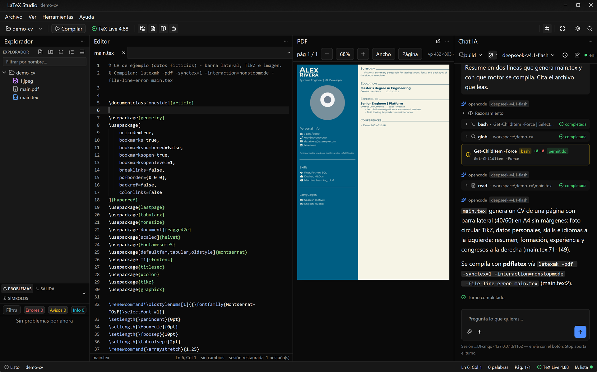
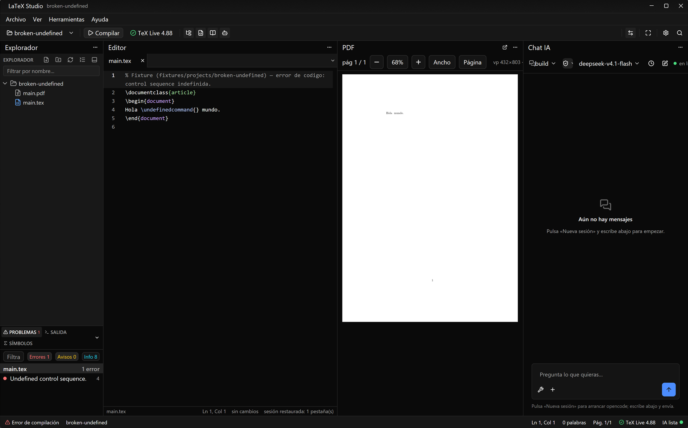

# LaTeX Studio

IDE LaTeX nativo (Rust + GPUI) y **portable**: 4 paneles — archivos · editor · PDF · chat IA —
con compilación al guardar, SyncTeX bidireccional y auto-reparación por agente.



- **Estado**: 0.2 en curso (pulido de producto) — ver `docs/board.md`.
- **OKF / wiki del proyecto**: `docs/kb/index.md` (punto de entrada para personas y agentes).
- **Plan de ejecución del swarm**: `docs/plan/` (README → PLAN-MAESTRO → INTERFACES → TAREAS → SWARM).
- **Plan incremental 0.2**: `docs/kb/changes/PLAN-0.2.md` · **changelog**: `docs/kb/changes/CHANGELOG.md`.
- **Gates y riesgos vivos**: `docs/gates.md`.

## Capturas

**Errores de compilación en contexto.** El log de `latexmk` se convierte en diagnósticos:
panel de problemas con el error y su línea, y estado de compilación en la barra inferior.



> Capturas generadas con los fixtures del repo (`fixtures/projects/`), sin datos personales.
> Cómo regenerarlas: `docs/img/README.md`.

## Desarrollo

```powershell
cargo run -p latex-studio        # abre la ventana (requiere toolchain stable >= 1.92)
cargo fmt --check
cargo clippy --workspace --all-targets -- -D warnings
cargo nextest run --workspace    # o cargo test --workspace
make release                     # instalador local en dist\LaTeX-Studio-Setup.exe
make gates                       # fmt + clippy + tests + OKF
```

La raíz portable se detecta por: `LATEX_STUDIO_ROOT` → directorio del exe → raíz del repo (dev).
`tex/`, `agent/`, `workspace/` y `legacy/` no se versionan (activos locales del usuario/distro).

Licencia: MIT (ver `docs/plan/PLAN-MAESTRO.md` §8 para terceros).
